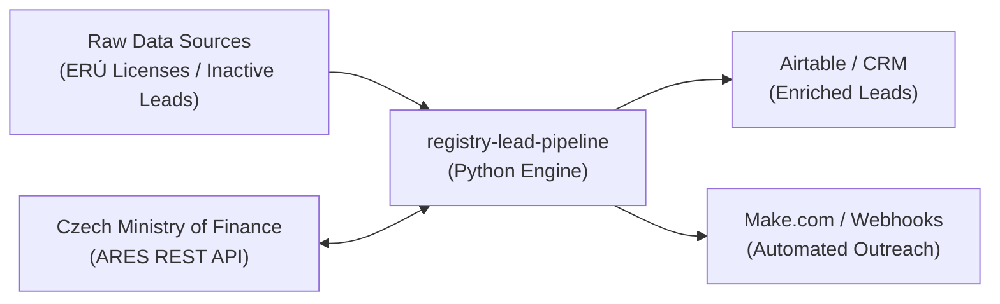

# 🏢 Czech Registry Lead Pipeline (`registry-lead-pipeline`)

An automated B2B lead enrichment pipeline connecting Czech public administrative registries (**ARES**) with commercial sector data to streamline business identification, statutory representative lookup, and CRM onboarding.

---

## 📌 Real-World Case Study: Enerkom (Energetická Komunita)

This pipeline was designed and deployed for **Enerkom** (a Czech community energy initiative with 90+ active members) to solve a critical acquisition challenge:
- **Objective:** Identify and onboard at least **2 MW of commercial renewable production capacity** before the community's general assembly (*valná hromada*).
- **Challenge:** The national energy regulator (**ERÚ**) publishes raw, flat lists of technical production licenses without statutory representative names or standardized business identifiers. Manually matching thousands of records to find warm personal contacts was infeasible.
- **Solution:** This automated pipeline reads technical energy license records, queries the official Czech Ministry of Finance **ARES REST API**, extracts standardized legal company names, registered addresses, and CZ-NACE industry classifications, and packages the data into an actionable format for sales and outreach.

---

## ⚡ Key Features

- **Batch REST API Ingestion:** Direct integration with official Czech government endpoints (`ares.gov.cz`) with automated rate limiting and retry handling.
- **Data Normalization:** Automatic formatting and validation of 8-digit identification numbers (IČO), structured address extraction, and CZ-NACE mapping.
- **Multi-Format Export:**
  - `enriched_leads.csv`: Formatted with UTF-8 BOM encoding for direct import into **Excel** and **Airtable**.
  - `enriched_leads.json`: Clean structured payloads ready for **Make.com**, **Zapier**, or custom webhook workflows.
- **Built for AI Orchestration:** Clean, modular structure designed to be easily maintained, extended, and monitored using modern AI coding agents (Claude Code, Cursor, Antigravity).

---

## 🛠️ Architecture



---

## 🚀 Quickstart

### Prerequisites
- Python 3.9+
- `pip`

### 1. Installation
```bash
git clone https://github.com/YOUR_USERNAME/registry-lead-pipeline.git
cd registry-lead-pipeline
pip install -r requirements.txt
```

### 2. Run the Pipeline
```bash
python pipeline.py
```

### 3. Sample Output (`enriched_leads.json`)
```json
{
  "ico": "27082440",
  "company_name": "Alza.cz a.s.",
  "legal_form": "Akciová společnost",
  "registered_address": "Jankovcova 1522/53, Holešovice, 17000 Praha 7",
  "city": "Praha",
  "postal_code": "17000",
  "installed_capacity_kw": 250.0,
  "source_license_type": "FVE / Commercial Solar",
  "is_active": true,
  "lookup_status": "SUCCESS"
}
```

---

## 🔗 Integrations & Ecosystem

- **Airtable & CRM:** Ready-made columns matching standard B2B CRM structures.
- **Apify & Web Scraping:** Can be paired with Apify actors to scrape regional registries before feeding into this pipeline.
- **Make.com Automations:** Easily triggered via GitHub webhooks or scheduled cloud tasks.

---

## 👤 Author

**Jaroslav Karbusický**  
- Student of **Digitální podnikání** (Digital Business) at Univerzita Pardubice (FES)  
- Focus: AI Agents, Automation Pipelines, Apify, Airtable, Make.com  
- Contact: `jara.karbusicky@gmail.com` | [LinkedIn](https://linkedin.com/in/jaroslavkarbusicky)
